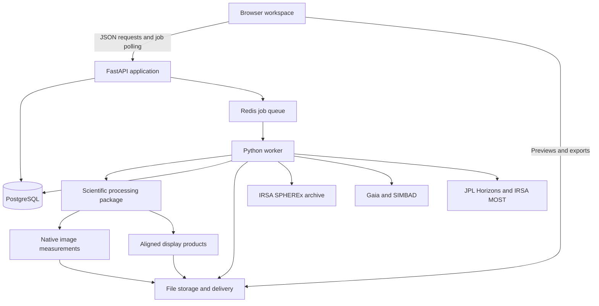
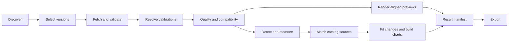

# SPHEREx research viewer — web app architecture

Prepared 10 November 2026. Status: proposed implementation design. This document does not imply that the new backend or scientific measurements have been implemented or validated.

## 1. Product decision

Build an astronomer-focused workspace for inspecting changes in real SPHEREx observations. Keep the main workflow accessible to anyone:

**Enter a sky position → find observations → compare aligned dates → select an object → inspect measurements and uncertainty → export the evidence.**

The main scientific questions are whether a source moved, whether its brightness changed, whether those changes exceed the measurement uncertainty, and whether an image problem could explain them. Every result should let an astronomer trace the answer back to the original observations.

Use one repository, a React browser interface, a Python API, and a separate Python worker for expensive calculations. PostgreSQL holds metadata and results. File storage holds FITS data and rendered previews. Redis carries background jobs. Begin with one worker and increase capacity when measured demand justifies it.

### Priorities

| Priority | Deliverable | Definition of success |
|---|---|---|
| P0 | Coordinates, field size, archive search, aligned date playback | An arbitrary supported sky patch can be opened and inspected, with missing coverage explained |
| P0 | Data quality and provenance | Every displayed frame has its observation time, footprint, wavelength information, release and source link |
| P1 | Known-object overlays and target highlighting | Labels distinguish catalog positions from positions measured in the image |
| P1 | Motion and brightness measurements | Results include uncertainty, quality reasons and downloadable evidence |
| P1 | Five required challenge targets | Each has a reproducible validation case, including honest non-detections |
| P2 | Compatible stacking, subtraction and spectra | Each result preserves its contributing dates, wavelengths and processing settings |
| P2 | Short-term predictions | Observed positions and model projections are separately identifiable |
| P3 | Sun-relative 3D scene | Positions use documented distance data and missing velocity components are visible |
| P3 | AI explanations or quality ranking | AI describes validated numerical outputs and never creates measurements |

These are recommended engineering priorities, not claims about an official judging rubric. This scope supports the supplied challenge requirements and a **Best Use of Data** submission. A **Best Use of Science** case depends on the validation results.

## 2. Starting point in this workspace

The [existing viewer](<C:/Users/Hong Zhe/Documents/Codex/2026-11-10/since-2025-nasa-s-spherex-mission/outputs/spherex-viewer/index.html>) is a useful prototype. Its manifests currently contain six fields, 22 dated FITS crops and 52 full-detector previews. It already has date playback, detector selection, a full-detector view, an aligned crop view and archive links. Vesta is the additional demonstration field alongside the five challenge targets.

Reuse the downloaded files, provenance records, layout ideas and playback interactions. Import them through the new validation pipeline before treating them as scientific analysis inputs.

The prototype still needs these changes:

- Replace fixed JavaScript manifests with a versioned API, while keeping a cached demonstration mode.
- Replace generic “Flagged” labels with decoded, release-specific flag meanings. A nonzero flag value does not automatically mean the source is unusable.
- Keep a requested detector or wavelength selection fixed during scientific comparisons. An unavailable observation becomes a visible gap.
- Check the actual shared sky footprint when switching detectors.
- Replace independently stretched previews with a shared brightness scale when comparing brightness.
- Audit wavelength lookup and original-detector pixel coordinates against official examples, including indexing conventions.
- Add uncertainties, source matching and independent numerical measurements.
- Validate available archive collections through a registry. An unverified collection name in an older script must not become a production dependency.

The existing files establish a starting dataset. They do not yet establish the accuracy of a motion fit, a spectrum or a distance estimate.

## 3. System structure



### Stack and responsibilities

| Layer | Recommended choice | Responsibility |
|---|---|---|
| Browser | React, TypeScript, Vite, React Router | Search, viewer controls, target selection and shareable URLs |
| Browser data fetching | TanStack Query | Request state, caching and background-job polling |
| Image viewer | Canvas 2D plus SVG overlays initially | Display server-rendered images with shared pan, zoom and source markers |
| Charts | Plotly.js, loaded when needed | Position, brightness and spectrum plots with error bars |
| API | FastAPI and Pydantic | Validate requests, describe capabilities and return versioned results |
| Scientific processing | Astropy, NumPy, SciPy, reproject, Photutils | Coordinates, FITS, alignment, fitting and uncertainties |
| Archive clients | PyVO, Astroquery and an HTTP client | Access official image and catalog services |
| Jobs | Celery and Redis | Durable processing with retries, cancellation and progress |
| Database | PostgreSQL, SQLAlchemy, Alembic | Observation inventory, analysis records and migrations |
| Files | Filesystem locally; S3-compatible storage when hosted | Original inputs, derived FITS, previews and export packages |
| Optional 3D | Three.js | Render positions calculated by the Python backend |
| Development/deployment | Linux containers with Docker Compose | Reproducible API, worker, database and queue on a Windows development machine |

React's documentation covers a Vite-based application setup; this project can use a static frontend because the Python service owns the scientific backend. Plotly supports the required error-bar plots. Use tested, locked dependency versions when implementation begins. [React setup](https://react.dev/learn/build-a-react-app-from-scratch), [Plotly error bars](https://plotly.com/javascript/error-bars/).

Keep expensive work outside HTTP request handlers. FastAPI explicitly points to a worker system such as Celery for substantial background computation. Celery sends tasks to workers through a broker. Queue messages should contain record IDs and settings, while the large arrays remain in file storage. [FastAPI background work](https://fastapi.tiangolo.com/tutorial/background-tasks/), [Celery architecture](https://docs.celeryq.dev/en/stable/getting-started/introduction.html).

Use one Python package shared by the API and worker. Functions in the scientific package should accept arrays, metadata and typed parameters without depending on HTTP requests or React state. This makes the same calculation usable in a notebook and in the app.

## 4. User interface

### Search and entry

Provide a search form with object name or RA/Dec, field width and height, date range, and optional wavelength constraints. Accept decimal degrees and clearly identified hour/minute/second coordinates. Show the parsed position before submitting. A sky search center is distinct from an object's position at a particular date.

Place the five challenge presets beside the form. Each preset opens an actual saved analysis with known inputs. Add a concise explanation of what can be investigated in that field.

### Main workspace

```text
Object / RA / Dec       Field size       Date range       Search

Observations        Aligned sky viewer              Selected object
and filters         Pan / zoom / cursor position    Identity and source IDs
                    Catalog and measured markers   Measurement quality
Date                Frame A / frame B / blink       Motion / brightness
Detector            Difference / stack             Source data and export
Wavelength
Quality             Timeline with real observation dates

Analysis tabs       Positions | Brightness | Spectrum | Provenance | 3D
```

Maintain two explicit viewing modes:

| Mode | Purpose | Display rules |
|---|---|---|
| Aligned sky patch | Compare the same location across dates | Shared sky grid, orientation and field size; comparison brightness scale locked by default |
| Full detector | Inspect surrounding context and artifacts | Original footprint and orientation; show whether the chosen target lies inside |

Switching bands preserves the requested sky patch in aligned mode. Empty regions remain empty. Full-detector mode displays a footprint inset so neighboring sky cannot be mistaken for the same field.

In the timeline, show actual gaps between observations. Offer equal-step blinking and elapsed-time playback as separate options. Preload adjacent frames. Default to a sky-fixed view for motion inspection. A later “follow target” mode must state that the background will move as the view tracks the target.

Use both shape and text to distinguish marker types:

- Circle — position measured from an image.
- Crosshair — catalog position propagated to the observation time.
- Dashed path — model prediction outside the observed dates.

The information panel shows values with units and uncertainty. A source can have a known catalog label without a reliable detection in the current image.

### State and sharing

Keep simple search parameters in the URL, for example `/explore?ra=269.44625&dec=4.7675&fov=20`. These are search coordinates, not a claim about a dated target position.

Use `/analysis/{id}` for an immutable analysis snapshot with exact releases, input files and processing settings. Changing scientific settings creates a new analysis revision. Changing pan, zoom or color changes only the view state.

Support a compact read-only `/embed/{share_id}` route after the main workflow works. Browsing and opening public demonstrations should require no account. Add accounts later if private saved projects or collaboration are needed.

## 5. External data and adapter boundaries

| Adapter | Input | Returned data | Role |
|---|---|---|---|
| SPHEREx search | Sky region, time interval, collection | Observation metadata and file references | Discover relevant exposures |
| SPHEREx download | Verified archive reference and optional crop | FITS bytes and headers | Retrieve numerical image data |
| Calibration resolver | Product release and calibration references | Versioned wavelength, PSF and other required calibration products | Interpret the numerical data correctly |
| SIMBAD | Name or sky position | Identifiers, coordinates and object information | Resolve names and add labels |
| Gaia | Sky region and requested catalog fields | Positions, motion, distance-related measurements and uncertainties | Match sources and provide independent comparisons |
| Horizons / MOST | Solar System object, dates and observer context | Predicted positions or matching archived observations | Support Vesta and later asteroid workflows |
| WISE, later | Region and product selection | Infrared catalog entries or imagery with dates | Context for sources poorly represented in visible-light catalogs |

SPHEREx image discovery supports SIA2 at `https://irsa.ipac.caltech.edu/SIA`, with collection, position and time constraints. Current documentation lists QR2 and QR3 wide and deep collections. It also documents cutout requests on returned archive URLs. Store collection support as configuration checked against the archive. [SPHEREx data access](https://caltech-ipac.github.io/spherex-archive-documentation/spherex-data-access/).

SIA wavelength constraints are in meters and match an observation's overall wavelength coverage. Convert units explicitly. A search hit still needs a target-specific wavelength check. [IRSA SIA parameters](https://irsa.ipac.caltech.edu/ibe/sia.html).

Use SIMBAD name and region queries, and Gaia TAP/ADQL queries through maintained clients. Store provider, catalog release, query and retrieval date with each response. Do not assume every infrared target has a Gaia entry. [SIMBAD queries](https://docs.astropy.org/projects/astroquery/en/latest/simbad/simbad.html), [Gaia queries](https://docs.astropy.org/projects/astroquery/en/latest/gaia/gaia.html).

### Adapter contract

```python
class ImageArchive:
    def search(self, region, time_range, collections): ...
    def fetch_product(self, product_reference, crop=None): ...
    def resolve_calibrations(self, product_metadata): ...

class CatalogProvider:
    def resolve_name(self, name): ...
    def query_region(self, region, fields): ...

class EphemerisProvider:
    def positions(self, object_id, times, observer): ...
```

These are proposed internal interfaces, not existing provider API signatures. Each adapter normalizes remote responses into app-owned types and retains the original response for auditing. Changes to an archive endpoint should be isolated to its adapter.

## 6. Data representation

A SPHEREx spectral image provides numerical brightness, pixel flags, variance, a zodiacal-background model, a spatially varying PSF and wavelength lookup information. A detector covers a range of infrared wavelengths whose values vary across its pixels. The archive documentation specifies `CWAVE` and `CBAND` calibration images for scientific wavelength work, while `WCS-WAVE` supports visualization. [SPHEREx data products](https://caltech-ipac.github.io/spherex-archive-documentation/spherex-data-products/).

Build the following internal representation:

```text
NativeExposure
  immutable original FITS reference and checksum
  observation start, midpoint and end with time scale
  mission, observation ID, detector, release and processing version
  image values, variance and original integer flags
  celestial coordinate mapping and coordinate convention
  original-detector pixel mapping for cropped data
  calibrated wavelength and bandwidth references
  local PSF reference and any required pixel-area calibration
  footprint, available pixels and calibration dependency IDs
```

Keep three product categories:

| Category | Contents | Allowed uses |
|---|---|---|
| Original inputs | Downloaded FITS, headers, catalog snapshots and calibration files | Reprocessing and numerical measurement |
| Scientific results | Measurements, covariance, aligned arrays, masks, fits and recipes | Quantitative inspection and exports |
| Display products | PNG previews, thumbnails, assigned colors and video | Browsing and presentation |

The scientific functions must accept numerical arrays or scientific product IDs. They must never read pixel values from a colored JPEG or a contrast-stretched screenshot.

### Units and time rules

- Use degrees for stored RA/Dec, with an explicit frame. Preserve coordinate epoch separately from coordinate frame.
- Use micrometers for app wavelength fields, converting to service-specific units at adapter boundaries.
- Preserve original time keywords and their scale. Display UTC. Fit using an explicitly chosen time representation, such as Julian years from a reference epoch.
- Store the measurement unit with every flux value. Conversion from surface brightness to source flux requires pixel-area handling and appropriate extraction calibration.
- Use `null` for missing values. Zero remains a measured or modeled number.
- Preserve negative flux estimates from noisy measurements. Detection status and upper limits are separate fields.
- A reported proper-motion RA component must say whether it includes the cosine of declination, matching the chosen convention.

## 7. End-to-end processing

### Stage A — discover and freeze inputs

1. Validate coordinate syntax, region size and time range.
2. Query all exposures overlapping the requested region. A rectangle needs a covering search region followed by an exact footprint check.
3. For a known fast-moving source, account for the path and coordinate epoch when choosing search regions.
4. Detect truncated archive results. Narrow or partition the query instead of presenting incomplete results as complete.
5. Group alternative reductions of the same physical observation and detector. Preserve all versions in the inventory, but select one for a given analysis.
6. Download required cutouts or full files. Verify FITS structure, observation identity, time, detector, units and checksum.
7. Resolve calibration dependencies using the release and product metadata.
8. Freeze an input manifest. New archive data can create another revision later.

Use midpoint times for measurements when appropriate, calculated from validated exposure metadata. Keep start and end times available. Include motion during exposure in the model if it is large enough to affect a fit.

### Stage B — determine what can be compared

Calculate a compatibility report for each requested comparison:

```text
sky_overlap
target_inside_footprint
time_separation_and_exposure_duration
target_wavelength_and_bandwidth
passband_compatibility
mask_coverage_around_target
available_calibrations
release_compatibility
alignment_quality
allowed_operations
reasons
```

Allowing an image to be viewed does not automatically make it suitable for a brightness measurement or subtraction. The report should return operation-specific outcomes such as `visual_comparison`, `position_measurement`, `flux_comparison` and `difference_image`.

Compatibility limits belong in a versioned scientific policy. Establish them through the validation set. Avoid a universal claim that two wavelengths within an arbitrary fixed percentage are always comparable.

Prefer a consistent processing release for a quantitative series when coverage permits. Mixing releases requires an explicit policy and checks for calibration offsets using suitable control sources. Record the choice in the manifest. Newer processing is not an additional independent observation.

### Stage C — quality and background

Decode integer flags with definitions appropriate to the release. Maintain separate policies for fitting a source, estimating background and rendering an image. Keep the original flags alongside each policy's derived mask and rejection reasons.

Estimate local background with neighboring sources and unusable pixels excluded. Record whether a supplied background model was applied. Ensure the same component is not subtracted twice. Keep a count of usable pixels and diagnostics for structured residual background.

Never overwrite the input image with a smoothed or AI-generated version. An optional smoothed preview is a distinct display product.

### Stage D — align the display

Define one celestial grid for a comparison, including center, width, height, pixel scale and orientation. Reproject each image onto that grid. Use a coverage map to mark gaps. The reproject package offers interpolation and flux-conserving alternatives with different tradeoffs. [Reprojection methods](https://docs.astropy.org/projects/reproject/en/stable/celestial.html).

Refine alignment, where justified, using multiple reference stars distributed across the field. Propagate their catalog positions to the observation date and exclude the target under test. Store reference IDs, residuals, rejected matches and the fitted transformation.

Resampling must treat data types appropriately. Brightness can be interpolated. Flag masks need a defined contributor rule. Variance propagation needs squared interpolation weights and awareness of correlations between output pixels. A brightness resampling routine is not a general variance propagator.

### Stage E — measure on native data

Measure each source in the original calibrated pixel grid, then transform its fitted position to sky coordinates using the validated mapping and any recorded alignment correction. This avoids making display interpolation part of the primary measurement.

Start with background estimation and source detection. Use aperture measurements for suitable isolated sources, and local PSF fitting for positions and overlapping sources. Photutils provides these tools, but instrument-specific calibration and acceptance criteria remain the app's responsibility. [Photutils PSF fitting](https://docs.astropy.org/projects/photutils/en/stable/user_guide/psf.html), [aperture measurements](https://docs.astropy.org/projects/photutils/en/stable/user_guide/aperture.html).

Select the correct PSF region using original-detector coordinates, even when processing a crop. Verify the conversion between FITS and Python pixel conventions with official examples. [IRSA cutout PSF tutorial](https://caltech-ipac.github.io/irsa-tutorials/spherex-psf/).

Return position and flux uncertainties, fit residual diagnostics, local background, blend status, relevant flags and a measurement mode. Distinguish a freely fitted position from a position held fixed during forced photometry. A fixed-position fit provides no independent evidence of motion.

Track which calibration corrections the input already includes and which the extraction applies. Applying a correction twice can bias a result. Shared reference stars and calibration errors can also correlate measurements across dates; model or bound those effects when quoting a fitted change.

### Stage F — summarize and publish results

Fit accepted measurements, generate charts and previews, then write an immutable result manifest. Every UI value refers to a measurement or model result ID. Failed or excluded frames remain listed with reasons. Partial results can be inspected while remaining work continues.

## 8. Scientific feature modules

### 8.1 Known-object labels

Implement labeling as a coordinate-matching problem:

1. Resolve a requested name and collect catalog candidates over the field, including a margin for motion since the catalog epoch.
2. Propagate candidates to each observation time.
3. Detect and fit image sources independently.
4. Generate plausible matches using angular separation and combined position uncertainty.
5. Compare candidate assignments, including nearby alternatives and blending.
6. Record `matched`, `ambiguous`, `catalog_only` or `unmatched_detection`.

For isolated sources, use an uncertainty-aware nearest-candidate match. For crowded groups, use joint fitting and assignment constraints. One low-resolution spot may contain several catalog objects, so retain a blend relation rather than forcing every match to be one-to-one.

Astropy can propagate catalog positions under a constant-space-velocity model. Observer-dependent apparent shifts require additional treatment consistent with the image's coordinate convention. [Astropy space motion](https://docs.astropy.org/en/stable/coordinates/apply_space_motion.html).

An unmatched spot is a candidate for inspection. It is not automatically a newly discovered object.

### 8.2 Motion

Fit positions on a local tangent plane, which expresses offsets in small sky angles and avoids RA wraparound problems. Begin with weighted straight-line motion in two dimensions. Use complete position covariance where available, and include an empirically justified alignment/systematic uncertainty component.

Two accepted dates support a displacement estimate. Additional well-separated dates support a rate fit and checks of its residuals. Repeated observations minutes apart do not provide the same leverage as a long time baseline. Detectability depends on displacement relative to total uncertainty.

Report angular displacement, direction, rate, time baseline, number of independent dates, uncertainty and residuals. Keep catalog motion separate from image-derived motion. Treat parallax and acceleration fits as later capabilities requiring suitable cadence and evidence that the data constrain the extra parameters.

For validation, do not lock the target's position to the reference catalog and then claim that agreement proves a measured motion. Exclude the target from the alignment solution and fit it independently.

### 8.3 Brightness and difference images

Build light curves from measurements with compatible spectral response. Retain wavelength and bandwidth for each point. A detector label alone is insufficient for defining a time series.

For difference images, require adequate shared sky coverage, suitable wavelength response, compatible calibration, matched source shape and a documented background/flux normalization. Evaluate wavelength compatibility across the compared area; matching only the target's central pixel may be insufficient for a whole-field subtraction.

Produce a difference image, its mask and an uncertainty or significance product whose assumptions are recorded. Keep negative values. If the comparison fails its requirements, return the specific reason and offer ordinary side-by-side viewing.

### 8.4 Stacking

Support distinct recipes for a deeper context image and for a time-resolved analysis. Define the time interval and spectral selection before combining anything. For compatible independent measurements, inverse-variance weighting is a starting method. Propagate correlations or systematic terms when those assumptions fail.

A stack should retain contributing IDs, per-pixel coverage, effective wavelength information and time span. Limit time bins so expected motion does not smear the target beyond the analysis tolerance. Any target-aligned stack is a separate product because the background sources will be shifted.

Broad detector-range composites can be useful for browsing. Their changing spectral mixture must remain explicit when interpreting brightness across dates.

### 8.5 Spectra and band comparison

Design a sparse time-versus-wavelength browser. For a selected source, display available observations, actual dates, wavelength widths, flux and error bars. Preserve missing cells. Describe the chosen time window and how long it took to gather the displayed spectrum.

A full 102-channel view is assembled from available observations. It must not imply that every channel was captured at one instant. Use a coverage matrix before displaying a complete-looking spectral curve.

IRSA's spectrophotometry tool uses source positions and PSF-based forced photometry, and exposes wavelength, flux, errors, flags and exposure provenance. It can require minutes to hours. Use it as a reference workflow and optional comparison/import source; verify a supported programmatic interface before making it a dependency. [IRSA spectrophotometry](https://irsa.ipac.caltech.edu/onlinehelp/spherex/spherex/sp.html).

For a moving target, extract at each dated position. A variable source's measurements taken at different times may combine temporal and spectral change. Keep that distinction visible.

### 8.6 Predictions and 3D

For known stars, offer catalog-based propagation and, separately, propagation from the app's fitted motion. Display the fit interval, prediction interval and uncertainty. For asteroids, use an ephemeris service with the relevant observer configuration. MOST can locate archived observations along a Solar System object's predicted path; Horizons provides an API for ephemerides. [IRSA MOST](https://irsa.ipac.caltech.edu/applications/MOST/), [Horizons API](https://ssd-api.jpl.nasa.gov/doc/horizons.html).

The 3D service requires a distance estimate in addition to sky position. A full velocity requires motion across the sky, distance and motion toward or away from us. Use catalog or published distance estimates with uncertainties. Simple inversion of a noisy parallax can be misleading. [Gaia guidance on distances](https://arxiv.org/abs/1804.09376).

Convert catalog quantities into a documented Cartesian frame, and subtract the Sun's position and velocity consistently for a Sun-relative view. State whether the model uses straight-line propagation and how far it is shown. Use a separate observer-based projection to compare that model with images.

When radial velocity is missing, label a transverse-only projection or omit the full path. An assumed zero radial velocity must be explicit. Astropy's propagation defaults to zero when that input is absent and assumes constant velocity. [Astropy propagation assumptions](https://docs.astropy.org/en/stable/coordinates/apply_space_motion.html).

Three.js renders the resulting scene; it does not estimate astronomical distances or orbits. [Three.js documentation](https://threejs.org/docs/).

### 8.7 AI boundary

Build deterministic quality diagnostics first. For motion, rank by position uncertainty, alignment quality and contamination. For brightness, rank by flux uncertainty, spectral compatibility and fit quality. There is no universally “most accurate band.”

AI can later summarize why a measurement was accepted, explain a plot or prioritize candidates for human review. Its input should be structured measurements with provenance. Its output must cite those record IDs. It must not modify scientific arrays or invent missing observations.

Only show a probability when its event is defined and its calibration has been tested on an independent dataset. For example, a calibrated probability of recovering a source within a stated positional tolerance is meaningful; an unexplained “97% accurate band” is not.

## 9. Database model

Store numerical scalars and relationships in PostgreSQL. Store large arrays as files. Use UUIDs for internal records and retain provider IDs as separate fields. Schema migrations accompany every database change.

| Table or table group | Main fields | Important constraint |
|---|---|---|
| `archive_releases` | Provider, collection, release, capabilities, discovery time, enabled state | Only verified collections are enabled |
| `observations` | Mission, observation ID, detector, time bounds, midpoint, footprint | A physical exposure/detector is independent of its later processing versions |
| `source_products` | Observation ID, release, processing version, source URL, artifact ID | Alternative reductions link to the same observation |
| `artifacts` | Object key, SHA-256, byte count, media type, validation state | Content is immutable after validation |
| `calibrations`, `product_calibrations` | Calibration type/version/artifact and product association | Each analysis can recover its exact calibration dependencies |
| `catalog_snapshots` | Provider, release, query, retrieval time, raw artifact | Catalog refreshes create new snapshots |
| `sources` | Internal source ID, external identifiers, reference position/epoch, source type | A name alone is not a unique identity |
| `analyses` | Input region, time range, recipe, policy version, code version, status, parent revision | Completed scientific settings are immutable |
| `analysis_inputs` | Analysis ID, selected source product IDs, catalog/calibration references | Input selection cannot silently drift after a refresh |
| `jobs`, `job_events`, `job_outbox` | Stage, attempt, heartbeat, progress, error code, cancellation request | PostgreSQL is the durable source of job state |
| `detections`, `source_matches` | Native position, candidate identity, separation, matching method, ambiguity | A detection can remain unmatched or represent a blend |
| `measurements` | Analysis/source/product IDs, position, flux, covariance, wavelength, time, quality, fitting mode | Every result links to its exact source exposure and recipe |
| `models`, `model_inputs` | Type, reference epoch, parameters, covariance, fit interval, diagnostics, input measurements | Predictions are identifiable separately from observations |
| `shares`, optional `annotations` | Immutable analysis ID, view state, ownership/access information | A public link cannot mutate the original result |

Do not store all of Gaia locally for the MVP. Cache only queried regions and selected records. Use archive queries for image discovery. If the local inventory later needs spatial acceleration, add a spherical index such as HEALPix with an exact footprint check. RA wraparound and the celestial poles require spherical handling.

### Measurement contract

Every measurement should carry at least:

```text
measurement_id, analysis_id, source_id, source_product_id
time_mid, time_scale, exposure_duration
coordinate_frame, ra_deg, dec_deg, position_covariance
native_x_px, native_y_px, position_fit_mode
flux, flux_unit, flux_error, flux_fit_mode
wavelength_um, bandwidth_um, calibration_ids
mask_policy_version, raw_flag_summary, quality_reasons
fit_diagnostics, detection_status, upper_limit_if_applicable
pipeline_version, provenance_manifest_id
```

Not every record has every measurement. For example, forced photometry can have a flux result with no independent fitted position. Represent this explicitly through nullable fields and fitting modes.

### Observation versus result identity

Never use only `observation_id` as a file key. Include detector, release and processing version. Never count two reductions of the same exposure as two independent dates. A newly reprocessed file creates another product record, while the physical observation remains the same.

## 10. API design

Publish an OpenAPI schema from FastAPI and generate TypeScript response types from it. Prefix routes with `/api/v1`. Return structured error codes and readable reasons. Expensive requests return `202 Accepted` with a job ID.

| Endpoint | Purpose |
|---|---|
| `GET /capabilities` | Available collections, supported operations and resource limits |
| `GET /presets` | Five challenge targets and cached demonstrations |
| `POST /resolve` | Resolve an object name, returning ambiguity when needed |
| `POST /searches` | Start archive discovery for a validated region and time range |
| `GET /searches/{id}` | Search state, observations, coverage and truncation information |
| `POST /analyses` | Freeze selected inputs and submit a processing recipe |
| `GET /analyses/{id}` | Analysis state, manifest and available capabilities |
| `GET /analyses/{id}/frames` | Ordered display products, coordinate metadata and compatibility reasons |
| `POST /analyses/{id}/catalog-queries` | Start or reuse a cached catalog overlay query |
| `POST /analyses/{id}/measurements` | Submit source fitting for specified targets and observations |
| `GET /analyses/{id}/measurements` | Retrieve numerical measurements and uncertainty |
| `POST /analyses/{id}/models` | Fit a supported motion model to accepted measurement IDs |
| `POST /analyses/{id}/products` | Request a stack, difference, spectrum, export or optional 3D product |
| `GET /jobs/{id}` | Progress, completed artifacts and errors |
| `POST /jobs/{id}/cancel` | Request cancellation of remaining work |
| `POST /shares` | Create a read-only link to a specific analysis revision |

Use artifact IDs for downloads and pixel inspection. A pixel-inspection route receives a validated frame ID and pixel or sky position, then returns numeric values and quality information. It must use the frame's documented transform and account for any display-axis flip.

Example search request, using an approximate search center near Barnard's Star. This is an API design example, not an executed search or an epoch-specific source position:

```json
{
  "region": {
    "frame": "icrs",
    "ra_deg": 269.44625,
    "dec_deg": 4.7675,
    "width_arcmin": 20,
    "height_arcmin": 20
  },
  "time_range": {
    "start_utc": "2025-05-01T00:00:00Z",
    "end_utc": "2026-10-01T00:00:00Z"
  },
  "collections": ["spherex_qr3", "spherex_qr2"],
  "include_deep_fields": false
}
```

Example analysis request after the user selects observations:

```json
{
  "search_id": "example-search-id",
  "source_product_ids": ["example-product-a", "example-product-b"],
  "recipe": {
    "name": "aligned_comparison",
    "version": "1",
    "quality_policy": "preview-v1",
    "display_orientation": "north_up_east_left",
    "brightness_scale": "shared"
  }
}
```

The server resolves a recipe name to validated implementation settings. A preview recipe never authorizes a quantitative measurement by itself. Measurement jobs apply their own versioned scientific acceptance policy.

For each derived output, return `evidence_kind` as `measured`, `catalog`, `predicted` or `display`. Return operation eligibility and its reasons. This lets the frontend enforce the same distinctions as the backend.

An analysis action creates an immutable child run with its own input manifest. Newly fetched catalog snapshots, new targets or changed fitting settings therefore belong to a new child run or analysis revision. Adding derived results never rewrites an earlier result's inputs or scientific settings.

Use an `Idempotency-Key` for job-creating requests. Repeated requests with the same normalized parameters should reuse a compatible existing result or job. Different parameters using the same key return a conflict.

## 11. Worker execution and caching

### Processing graph



Catalog discovery can run alongside image discovery. A forced measurement of a known target can use a catalog position before detection. The graph above describes the independent-detection path.

Represent the overall job state as `queued`, `running`, `partial`, `completed`, `failed` or `cancelled`. Store the current stage and completed-item counts separately. Report “12 of 20 observations processed” when total duration is unknown.

Make each stage idempotent. Write output to a temporary object, validate it, then commit the artifact record. Retries cannot duplicate measurements or publish half-written files. Queue delivery can happen more than once, so correctness must not depend on a task running exactly once.

Create job and outbox records in a database transaction, then dispatch them to Redis. A dispatcher retries unsent entries. A heartbeat/reconciliation process recovers abandoned jobs. Redis loss must not erase the durable record of requested analyses.

Retry transient timeouts and provider rate limits with bounded backoff and jitter. Treat malformed FITS, a mismatched observation ID or unsupported calibration as explicit failures. Preserve successful frames when another frame fails. Cancellation stops new work and retains already committed artifacts for reuse.

### Cache keys

Use a canonical manifest hash containing:

```text
input checksums
calibration and catalog snapshot IDs
requested sky grid and coordinate convention
time and wavelength selection
quality and measurement policy versions
algorithm parameters
pipeline commit and dependency-lock hash
```

A view-only color change has a separate display cache key and does not invalidate measurements. A different flag policy or calibration creates new scientific results.

### Storage layout

Proposed object keys:

```text
source/{sha256}/original.fits
calibration/{sha256}/calibration.fits
catalog/{snapshot_id}/response.vot
analysis/{analysis_id}/manifest.json
analysis/{analysis_id}/frames/{frame_id}/aligned.fits
analysis/{analysis_id}/frames/{frame_id}/preview.png
analysis/{analysis_id}/measurements.ecsv
analysis/{analysis_id}/models.json
analysis/{analysis_id}/export.zip
```

Store source URLs in manifests even when files are cached. Deduplicate by content hash. Keep pinned demonstration inputs and saved-analysis dependencies. Expire disposable previews and abandoned job scratch files under a documented retention policy.

## 12. New releases and archive availability

Implement an explicit refresh command and, later, a scheduled refresh job. Check enabled collection metadata, discover new exposures and new reductions, and record the last successful check. Updating a catalog of available data must not silently revise an existing saved analysis.

IRSA documents weekly ingestion and a possible delay before new data appears through SIA. Provide a “last checked” timestamp and distinguish archive availability from the app's cache freshness. A TAP adapter can be added for documented queries when fresher discovery is needed. [SPHEREx access timing](https://caltech-ipac.github.io/spherex-archive-documentation/spherex-data-access/), [IRSA TAP cutout example](https://caltech-ipac.github.io/irsa-tutorials/spherex-cutouts/).

When an upstream service is unavailable, allow cached observations to remain usable with their retrieval dates. Return a specific error for uncached work. Missing archive coverage, failed retrieval and rejected scientific quality are different states in the UI.

## 13. Performance and deployment

### Initial operating limits

Treat these as proposed starting limits to benchmark, not measured service guarantees:

| Resource | Initial policy |
|---|---|
| Interactive field size | 1–60 arcminutes; larger fields become explicit batch work |
| Initial frame preparation | Prepare up to 20 representative observations, disclose selection, offer remaining frames |
| Per-job processed frames | Up to 100 initially; larger selections split into jobs |
| Remote downloads | Start with at most two concurrent downloads per host; honor provider restrictions |
| Worker CPU concurrency | Start with one heavy job; raise after measuring peak memory |
| Browser memory | Load visible and adjacent frames; evict distant decoded frames |
| Long spectra / crowded fields | Queue separately so ordinary browsing remains responsive |

Archive metadata search limits must be detected and disclosed independently of the app's frame-processing limits. A subset prepared for browsing must never appear to be the complete observing history.

Serve previews through static file delivery with caching headers. Fetch large numerical products only for inspection or download. Add multiresolution image tiles and browser-side brightness adjustment only after profiling demonstrates a need.

Benchmark a cached preset opening, an uncached 20-frame field, a measurement job and a large-field rejection. Measure time to first useful frame, download volume, peak worker memory, failed-exposure rate and total job duration. Set service targets from these results.

### Local and hosted layouts

For development, run the frontend with its development server and put API, worker, PostgreSQL and Redis in Linux containers. Use a mounted data directory. Keep a one-command Compose configuration and a small cached fixture dataset.

For an initial public deployment, serve the built frontend and `/api` behind one HTTPS origin. Run a persistent API process and a separate worker process or container. Use persistent PostgreSQL and file storage, with Redis accessible only to the application services. Avoid placing long-running FITS analysis inside a short-lived frontend function.

A small CPU machine is sufficient to begin benchmarking. No GPU is required for the core workflow. Increase worker capacity independently of the API when queues grow. Add a separate I/O queue or autoscaling only after demand and upstream limits justify them.

### Public-service controls

- Validate field size, dates, file size and per-job resource limits before work starts.
- Use short-lived anonymous session identifiers and quotas for public processing; keep viewing cached public results simple.
- Permit server-side downloads only from verified archive references and approved hosts. Revalidate redirects.
- Use parameterized database access and validated templates for external catalog queries.
- Authorize access to saved private analyses if accounts are introduced. Keep share links read-only.
- Keep queue and database services off the public network. Use JSON task messages and server-held credentials.
- Back up manifests, database records and pinned artifacts, and exercise a restore.

Log a request ID, analysis ID, job ID, stage, provider duration and structured failure reason. Monitor queue age, retrieval errors, processing failures, cache usage and storage growth. A healthy API with a stuck worker must not report the whole system as ready for new analysis.

## 14. Reproducibility and exports

The primary scientific deliverable is an evidence package that another researcher can inspect or rerun:

```text
README.md                 What was analyzed and how to reproduce it
manifest.json             Inputs, hashes, versions, settings and conventions
measurements.ecsv         Values, units, uncertainties and quality reasons
measurements.csv          Convenient table with unit-labelled columns
models.json               Parameters, covariance and prediction assumptions
regions.reg               Optional target and reference-star regions
previews/                 Labeled display products
derived/                  Optional scientific FITS products
source-links.json         Original archive links and catalog queries
```

Include original FITS inputs in a separate full export when their size is manageable, or provide verified retrieval instructions. Save processing environment information and the exact recipe. Record any nondeterministic seeds and numerical tolerances.

Do not turn a smoother-looking animation into a scientific claim. A video's labels must identify actual exposure times, assigned colors, excluded frames and any interpolated model path. Pixel interpolation between dates should never masquerade as an additional observation.

## 15. Validation plan

### Required fields

| Target | Main test | Expected handling |
|---|---|---|
| Barnard's Star | Independently fitted movement across a long baseline | Compare with a dated reference prediction; account for saturation, blending and positional uncertainty |
| Epsilon Indi B | Correct identity and treatment of a close pair | Show combined or blended light where the components cannot be separately measured |
| WISE 0855 | Faint moving infrared target | Evaluate long-wavelength observations; permit an upper limit or no reliable detection |
| RW Aurigae | Brightness variability | Compare compatible spectral response and assess contamination/blending |
| R Draconis | Brightness variability | Use a wavelength-aware light curve and report sampling gaps |
| Vesta, additional | Readily understood movement example | Keep archive/Horizons prediction separate from fitted position; assess flagged pixels and observer assumptions |

The existing presets are inputs for these tests, not completed validation results. Re-select observations when the current dates, wavelengths or quality are unsuitable.

### Scientific checks

1. **Identity and integrity.** Observation metadata agrees with FITS headers and cached checksums. Alternative processing versions are not double-counted.
2. **Coordinates.** Sky-to-pixel and pixel-to-sky round trips work, including RA wraparound, high declination, image-axis flips and cutout origins.
3. **Calibration mapping.** Wavelength and PSF selection agree with official examples at multiple detector locations. Unit conversions are explicit.
4. **Registration.** Reference stars distributed across the field have acceptable residuals. The target being evaluated is excluded from the alignment reference set.
5. **Motion recovery.** Inject known shifts into clearly labeled test copies and compare recovered shifts with uncertainty. Also compare independently measured real targets against external predictions.
6. **Brightness recovery.** Inject controlled brightness changes in test copies, and examine stable control sources under the same processing settings.
7. **Uncertainty coverage.** Check whether reported intervals contain known injected values at the expected frequency. A small formal fit error alone is insufficient.
8. **Failure cases.** Missing coverage, incomplete wavelength coverage, saturation, blends and unsuccessful downloads produce explicit states without invented values.
9. **Reproduction.** Rerunning a frozen analysis produces matching selected inputs and numerically equivalent outputs within a stated tolerance.

Choose acceptance limits before inspecting the final benchmark results. Publish limits, successes and failures together. Keep test injections separate from public science products and label them synthetic.

### Application checks

Use focused unit tests for coordinate parsing, units, quality decoding, matching and deduplication. Use small real FITS fixtures for integration tests of the scientific path. Test worker interruption, retry, cancellation and partial completion.

Use browser tests for search → playback → target selection → export. Verify a band with no coverage, a delayed job, a missing catalog match and a share link opened in a new session. Check keyboard controls, readable plot labels and non-color marker distinctions.

Do not depend on live external services for every test run. Add a separate bounded integration check against supported archive and catalog endpoints.

## 16. Suggested repository layout

The following is a proposed repository layout, not a claim that these directories already exist:

```text
spherex-app/
  apps/
    web/
      src/
        routes/
        features/search/
        features/viewer/
        features/measurements/
        features/spectra/
        features/provenance/
        api/generated/
  backend/
    app/
      api/
      models/
      services/
      adapters/irsa.py
      adapters/gaia.py
      adapters/simbad.py
      adapters/horizons.py
      workers/
      storage/
    science/
      ingest.py
      calibration.py
      quality.py
      coordinates.py
      compatibility.py
      registration.py
      detection.py
      matching.py
      photometry.py
      motion.py
      spectra.py
      rendering.py
      provenance.py
    migrations/
    tests/
  fixtures/
    manifests/
    small-fits/
  config/
    archive-collections.yaml
    quality-policies/
    recipes/
  docs/
    architecture.md
    validation.md
    data-dictionary.md
  infra/
    compose.yaml
  scripts/
    import_existing_demo.py
    refresh_archive.py
    reproduce_analysis.py
```

The frontend uses the API contract. The API and worker use application services. Services call archive adapters and the scientific package. The scientific package never imports frontend code or makes hidden catalog requests during a fit. External information enters it as explicit, versioned inputs.

## 17. Implementation milestones

### Milestone 0 — validate the starting assets

Import the existing manifests and FITS crops. Decode the relevant flags, audit pixel mappings and mark provisional wavelength estimates. Identify at least one pair suitable for an aligned visual comparison and list which scientific operations each pair supports.

**Exit condition:** every imported file has identity, provenance and an explicit eligibility report.

### Milestone 1 — complete the public viewing loop

Build the API, archive search adapter, job execution, aligned previews, field-size controls and shareable search URLs. Port the current playback interface. Add explicit missing-data and partial-job states. Keep the five presets available from cached data.

**Exit condition:** a user can enter coordinates, retrieve observations and play a consistent sky patch in time order.

### Milestone 2 — add astronomer-grade inspection

Implement catalog snapshots, propagated overlays, independent source fitting and a selected-target panel. Produce a position plot or a compatible-band brightness plot with uncertainty. Export source inputs and a reproducible measurement table.

**Exit condition:** one real result has independent validation and every displayed number is traceable. Exercise all five required fields, recording non-detections and unsupported measurements honestly.

### Milestone 3 — add comparison products

Implement quality-gated subtraction, documented stacking and a spectrum/time coverage view. Add numeric pixel inspection and richer reference-star diagnostics.

**Exit condition:** compatibility checks prevent misleading comparisons, and the derived results pass the scientific validation suite.

### Milestone 4 — add projections and 3D

Add short-term fitted/catalog predictions and a selected-source 3D scene using documented distance and velocity inputs. Keep unknown dimensions and model assumptions visible.

**Exit condition:** an observer can distinguish actual measurements, catalog information and model projections throughout the interface.

### Milestone 5 — evaluate AI assistance

Add structured explanations only after the numerical workflow is stable. Evaluate any ranking model against a defined task and an independent test set. Keep model/version information with generated explanations.

**Exit condition:** assistance improves interpretation or triage without changing the scientific evidence.

For a short hackathon, aim for Milestones 0 and 1, a narrow validated slice of Milestone 2, and honest checks on all five prescribed targets. The stronger demonstration is a complete coordinate-to-evidence workflow with one defensible measurement. Schedule spectra, wide-field products and 3D according to remaining time and demonstrated data quality.

## 18. Decisions to preserve during implementation

- The default scientific view compares a fixed sky patch across dates.
- Actual wavelength and coverage determine comparability.
- Native numerical data underlies measurements.
- Catalog identity, measured position and predicted position remain distinct.
- Every result carries uncertainty, quality reasons and provenance.
- Sparse or unsuitable data can legitimately produce no measurement.
- Saved analyses remain reproducible after archive updates.
- Public usability is part of the product, even when the main audience is astronomers.

The first implementation slice should connect the current cached viewer to a versioned manifest API, import and validate its existing FITS data, and then add arbitrary-coordinate archive search. This establishes the foundation on which the measurement tools can be tested.
